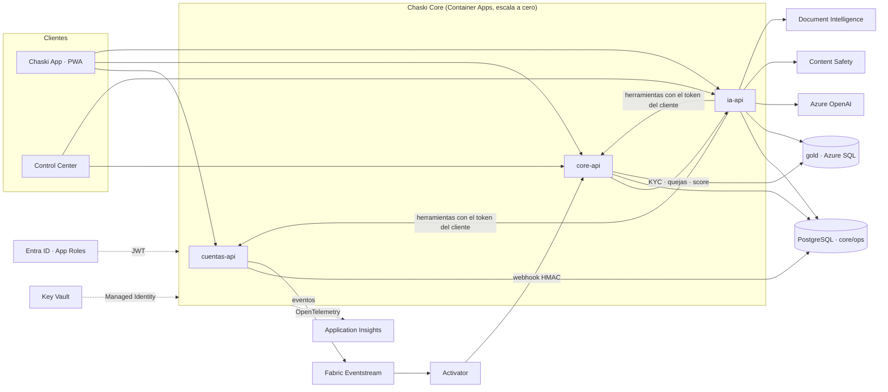

# Interbank CHASKI · Banca Inteligente en Tiempo Real

Proyecto final del curso **IT for Banking** (UTP + Interbank). Banco 100 % digital construido para Azure con IA generativa responsable, que corre completo **en local con Docker Compose sin Azure** y pasa a Azure **solo cambiando variables de entorno**.

| Pieza | Qué es |
|---|---|
| **Chaski App** | PWA móvil del cliente: onboarding con foto del DNI, saldo, movimientos, transferencias, pagos, tarjetas, préstamos, reclamos y el asistente IA |
| **Chaski Control Center** | Consola del banco: 11 módulos, cada rol ve solo los suyos |
| **Chaski Core** | `cuentas-api`, `core-api`, `ia-api` (FastAPI) |
| **Chaski Insights** | Esquema `gold` (Azure SQL en la nube), dashboards, NL2SQL y resumen ejecutivo |
| **Chaski Guard** | Motor de reglas de fraude (R1–R4) + webhook para alertas de Fabric |

## Levantar todo en 5 comandos

Requisitos: Docker Desktop y Git.

```bash
git clone <url-del-repo> chaski && cd chaski
cp .env.example .env
docker compose up -d --build
docker compose run --rm seed
# Abrir: http://localhost:3000 (Chaski App) y http://localhost:3001 (Control Center)
```

El `seed` crea 1,000 clientes, ~1,300 cuentas, ~900 tarjetas, 400 préstamos, ~60,000 transacciones en 6 meses, 150 quejas (3 con prompt injection) y la capa `gold`. Con `make` también sirven `make up`, `make seed`, `make live`, `make test`, `make lint` y `make docs`.

En local no hay contraseñas: la pantalla de ingreso muestra un **selector de usuarios de prueba** (8 roles del banco y clientes de muestra). Para tráfico continuo durante una demo: `docker compose run --rm live`.

| Servicio | URL |
|---|---|
| Chaski App | http://localhost:3000 |
| Control Center | http://localhost:3001 |
| cuentas-api | http://localhost:8001/docs |
| core-api | http://localhost:8002/docs |
| ia-api | http://localhost:8003/docs |
| PostgreSQL | `localhost:5432` (usuarios en `.env`) |

Guion de demo paso a paso: **[docs/DEMO.md](docs/DEMO.md)** · Endpoints y roles: **[docs/API.md](docs/API.md)** · Decisiones de diseño: **[docs/DECISIONS.md](docs/DECISIONS.md)**

## Arquitectura



## Stack

| Capa | Tecnología |
|---|---|
| Frontend | React 18, Vite, TypeScript, Tailwind v4, componentes estilo shadcn/ui (Radix), TanStack Query, React Router 7, Recharts, lucide-react, MSAL React |
| Backend | Python 3.12, FastAPI, Pydantic v2, SQLAlchemy 2, Alembic, httpx, structlog |
| Datos | PostgreSQL 16 (`core`, `ops`, `gold` local) · Azure SQL (`gold` en la nube) |
| IA | `openai` (AzureOpenAI), Azure AI Content Safety (Prompt Shields), Azure AI Document Intelligence, sqlglot. Todo detrás de interfaces con implementación mock |
| Observabilidad | OpenTelemetry → Application Insights (se activa solo con la connection string) |
| Calidad | pytest + httpx, Vitest + Testing Library + axe-core, ruff, mypy, ESLint, Prettier |

## Estructura

```
apps/cliente  apps/consola  packages/shared      # frontend (pnpm workspaces)
services/cuentas-api  services/core-api  services/ia-api
libs/chaski_common      # auth JWT, roles, auditoría, masking, logs sin PII, ledger, fraude, telemetría
genai/prompts           # prompts versionados (id, version, owner)
db/migrations           # Alembic: core, ops, gold + grants de mínimo privilegio
simulator/              # datos sintéticos (Faker es_ES adaptado a Perú) y modo --live
docs/                   # API.md (generado), DEMO.md, DECISIONS.md
infra/ .github/workflows/ data/ powerbi/ fabric/   # fuera de alcance (otros prompts)
```

## Seguridad (resumen)

- **Autenticación:** JWT validado en cada servicio (Entra ID: firma JWKS, issuer y audience). `AUTH_MODE=dev` se **rechaza al arrancar** si `CHASKI_ENV=PROD`.
- **Autorización:** `require_roles(...)` en cada endpoint. El `customer_id` sale del token, nunca del body. Todo 403 queda en `ops.audit_log`.
- **PII:** DNI, correo y teléfono enmascarados para todos los roles; solo Atención y Admin pueden revelarlos, con motivo y auditoría. Las tarjetas guardan **solo token + últimos 4 dígitos**.
- **Logs sin PII:** un procesador redacta DNI, correos, teléfonos y números de 13 a 19 dígitos en stdout **y** en el exportador de OpenTelemetry.
- **Secretos** solo por variables de entorno: en Azure, referencias a Key Vault con Managed Identity. Base de datos con roles de mínimo privilegio; NL2SQL usa un usuario que solo lee 3 vistas.
- **Cabeceras de seguridad**, CORS restringido, rate limiting, CSP generada en nginx, contenedores **sin root** y con `HEALTHCHECK`.
- **IA responsable:** Prompt Shields antes del modelo, salida JSON validada contra el esquema, validador de cifras, **la IA sugiere y el humano decide**, y cada llamada queda en `ops.ai_interactions` con la versión del prompt.

## Tests y calidad

```bash
uv sync --all-packages && pnpm install        # una vez
docker compose up -d postgres                 # los tests de backend usan una BD chaski_test
uv run pytest                                 # backend: auth, roles, PII, idempotencia, fraude, NL2SQL, IA...
uv run pytest services/cuentas-api --cov=cuentas_api --cov-fail-under=70
uv run ruff check . && uv run mypy libs/chaski_common/src services/*/src simulator/src
pnpm -r test && pnpm lint                     # frontend + accesibilidad (axe) + ESLint + tipos
uv run python scripts/gen_api_docs.py         # regenera docs/API.md
```

## Pasar a Azure

No se cambia código: solo variables (en Container Apps, como referencias a Key Vault). Ver `.env.example`.

| Variable | Valor en Azure |
|---|---|
| `CHASKI_ENV` | `TEST` o `PROD` |
| `AUTH_MODE` | `entra`, con `ENTRA_TENANT_ID`, `ENTRA_AUDIENCE`, `ENTRA_SPA_CLIENT_ID`, `ENTRA_API_SCOPE` |
| `DATABASE_URL`, `MIGRATIONS_DATABASE_URL` | Azure Database for PostgreSQL (`sslmode=require`) |
| `ANALYTICS_DB_URL`, `NL2SQL_DB_URL`, `ANALYTICS_DIALECT=tsql` | Azure SQL (`mssql+pyodbc`, ODBC Driver 18 incluido en las imágenes) |
| `AI_MODE=azure` + `AZURE_OPENAI_*`, `CONTENT_SAFETY_*`, `DOCINTEL_*` | Recursos de Azure AI (API key o Managed Identity) |
| `EVENTSTREAM_CONNECTION_STRING`, `EVENTSTREAM_NAME` | Fabric Eventstream (endpoint compatible con Event Hubs) |
| `FRAUD_WEBHOOK_SECRET` | Secreto compartido con Fabric Activator |
| `KEY_VAULT_URL`, `BLOB_ACCOUNT_URL` | Metadatos de secretos y fotos de KYC (Managed Identity) |
| `AZURE_SUBSCRIPTION_ID`, `AZURE_RESOURCE_GROUP`, `PIPELINE_JOB_NAME` | Container Apps Job del pipeline (inicio vía ARM) |
| `GITHUB_REPO`, `GITHUB_TOKEN` | Token de solo lectura para el módulo DevOps |
| `APPLICATIONINSIGHTS_CONNECTION_STRING` | Activa OpenTelemetry |
| `CHASKI_*_API_URL`, `CHASKI_POWERBI_EMBED_URL` | URLs públicas para las webs (se inyectan en `env.js` al arrancar) |
| `DEMO_MODE` | `false` en producción |
