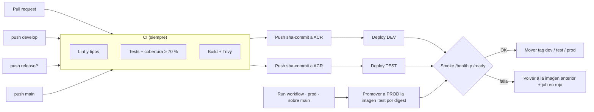

# CI/CD de `cuentas-api`

Pipeline: [`.github/workflows/cuentas-api.yml`](../.github/workflows/cuentas-api.yml) (nombre **`cuentas-api CI/CD`**).
Deploy reutilizable: [`.github/actions/deploy-containerapp`](../.github/actions/deploy-containerapp/action.yml).
Decisiones: D53–D64 en [`DECISIONS.md`](DECISIONS.md).

## 1. Flujo



| Evento | Qué corre | Environment | Credenciales Azure |
|---|---|---|---|
| Pull request a `develop`, `release/**` o `main` | Lint, tipos, tests, build y escaneo | — | **Ninguna** |
| push a `develop` | CI + publicar `sha-<commit>` + deploy | `build` → `dev` | OIDC |
| push a `release/**` | CI + publicar `sha-<commit>` + deploy | `build` → `test` | OIDC |
| push a `main` | CI (+ promoción si `PROD_AUTO_DEPLOY=true`) | `build` | OIDC (solo para publicar) |
| *Run workflow* → `prod` sobre `main` | Promueve a PROD la imagen etiquetada `test` | `prod` | OIDC |
| *Run workflow* → `dev`/`test` | Redeploy de un tag existente (`image_tag`) | `dev` / `test` | OIDC |

El pipeline solo se dispara si cambian `services/cuentas-api/**`, `libs/chaski_common/**`, `db/**`, `pyproject.toml`, `uv.lock`, `conftest.py`, el workflow o la action de deploy.

**Principios**
- **Build once, deploy many:** la imagen se construye y escanea una vez. A ACR sube exactamente esa imagen como `sha-<commit>`, y PROD despliega por *digest* la imagen que pasó por TEST, después de verificar (label `org.opencontainers.image.revision`) que su commit está en `main`.
- **PROD es una decisión humana.** GitHub Pro no permite *required reviewers* en repos privados (D60), así que PROD solo se despliega con *Run workflow* sobre `main`, y GitHub registra quién lo ejecutó.
- **Sin Azure configurado**, la publicación y los deploys se **saltan con un aviso** y la ejecución queda en verde.

## 2. Qué hace cada job

| Job | Detalle |
|---|---|
| **Lint and types** | `ruff check`, `ruff format --check`, `mypy` (chaski_common + cuentas-api) |
| **Tests and coverage** | PostgreSQL 16 real levantado con `db/init` y contraseñas aleatorias enmascaradas. pytest de cuentas-api + chaski_common con `--cov-fail-under=70`. Resumen en la página del run; `coverage.xml` y `junit.xml` como artefactos |
| **Build, scan and publish image** | Buildx con caché `gha`, labels OCI y tag `sha-<commit>`. Trivy falla con CRITICAL que tengan parche; el SARIF HIGH+CRITICAL queda como artefacto. En push sube a ACR **la misma imagen** |
| **Deploy DEV / TEST** | `az containerapp update` → smoke `/health` y `/ready` (hasta 240 s por el arranque en frío) → rollback si falla → mueve el tag `dev`/`test` |
| **Deploy PROD** | Resuelve `:test` (o `image_tag`) por digest, verifica que el commit esté en `main`, despliega, hace smoke/rollback y mueve el tag `prod` |

## 3. Configuración única en Azure

> Requisitos: Azure CLI ≥ 2.90 (`az login`), GitHub CLI (`gh auth login`) y permisos de *Owner* o *User Access Administrator* en el grupo de recursos (para asignar roles). Lo normal es que el prompt de **Bicep** cree estos recursos; los comandos de abajo sirven si aún no existen o para entender qué se necesita.

### 3.1 Variables

```bash
REPO="Matthewzegarra0312/chaski"
LOCATION="eastus2"
RG="rg-chaski"
ACR="acrchaski$RANDOM"            # nombre global único, solo minúsculas y dígitos
CAE="cae-chaski"                  # Container Apps environment
SUB_ID="$(az account show --query id -o tsv)"
TENANT_ID="$(az account show --query tenantId -o tsv)"
declare -A APP=( [dev]=ca-cuentas-api-dev [test]=ca-cuentas-api-test [prod]=ca-cuentas-api-prod )
```

### 3.2 Registro y Container Apps (si no los creó Bicep)

```bash
az group create -n "$RG" -l "$LOCATION"
az acr create -g "$RG" -n "$ACR" --sku Basic                       # ~USD 5/mes
az containerapp env create -g "$RG" -n "$CAE" -l "$LOCATION"

for env in dev test prod; do
  # Imagen temporal: el primer deploy del pipeline la reemplaza. Ingress externo (el smoke test
  # llama a la URL pública) y escala a cero.
  az containerapp create -g "$RG" -n "${APP[$env]}" --environment "$CAE" \
    --image mcr.microsoft.com/k8se/quickstart:latest \
    --ingress external --target-port 8000 --min-replicas 0 --max-replicas 2 \
    --system-assigned
  # La app descarga imágenes de ACR con su propia identidad (AcrPull), sin contraseñas.
  principal="$(az containerapp show -g "$RG" -n "${APP[$env]}" --query identity.principalId -o tsv)"
  az role assignment create --assignee-object-id "$principal" --assignee-principal-type ServicePrincipal \
    --role AcrPull --scope "$(az acr show -n "$ACR" --query id -o tsv)"
  az containerapp registry set -g "$RG" -n "${APP[$env]}" --server "$ACR.azurecr.io" --identity system
done
```

> ⚠️ **Antes del primer deploy real**, cada app necesita sus variables de entorno (`DATABASE_URL`, `AUTH_MODE=entra`, `ENTRA_*`, `CHASKI_ENV`, etc.) como referencias a Key Vault. Si falta `DATABASE_URL` o la base no tiene las migraciones, `/ready` responde 503, el smoke test falla y el pipeline **vuelve automáticamente a la imagen anterior**. Eso es lo esperado.

### 3.3 Identidades para GitHub (OIDC, sin secretos)

Una identidad administrada por environment de GitHub (mínimo privilegio):

| Identidad | Environment GitHub | Roles |
|---|---|---|
| `id-gh-chaski-build` | `build` | `AcrPush` en el ACR |
| `id-gh-chaski-dev` | `dev` | `AcrPush` en el ACR (mover el tag) + `Contributor` **solo sobre la Container App de DEV** |
| `id-gh-chaski-test` | `test` | `AcrPush` en el ACR + `Contributor` solo sobre la app de TEST |
| `id-gh-chaski-prod` | `prod` | `AcrPush` en el ACR (leer `:test`, mover `:prod`) + `Contributor` solo sobre la app de PROD |

```bash
ACR_ID="$(az acr show -n "$ACR" --query id -o tsv)"

for env in build dev test prod; do
  name="id-gh-chaski-$env"
  az identity create -g "$RG" -n "$name" -l "$LOCATION" -o none
  client_id="$(az identity show -g "$RG" -n "$name" --query clientId -o tsv)"
  principal="$(az identity show -g "$RG" -n "$name" --query principalId -o tsv)"

  # Solo los jobs que usan el environment "$env" de ESTE repo pueden obtener el token.
  az identity federated-credential create -g "$RG" --identity-name "$name" --name "github-$env" \
    --issuer https://token.actions.githubusercontent.com \
    --subject "repo:${REPO}:environment:${env}" \
    --audiences api://AzureADTokenExchange

  az role assignment create --assignee-object-id "$principal" --assignee-principal-type ServicePrincipal \
    --role AcrPush --scope "$ACR_ID"
  if [[ "$env" != "build" ]]; then
    az role assignment create --assignee-object-id "$principal" --assignee-principal-type ServicePrincipal \
      --role Contributor --scope "$(az containerapp show -g "$RG" -n "${APP[$env]}" --query id -o tsv)"
  fi

  # Variables del environment en GitHub (no son secretos: OIDC no usa contraseñas).
  gh variable set AZURE_CLIENT_ID       --env "$env" --repo "$REPO" --body "$client_id"
  gh variable set AZURE_TENANT_ID       --env "$env" --repo "$REPO" --body "$TENANT_ID"
  gh variable set AZURE_SUBSCRIPTION_ID --env "$env" --repo "$REPO" --body "$SUB_ID"
  gh variable set ACR_NAME              --env "$env" --repo "$REPO" --body "$ACR"
  if [[ "$env" != "build" ]]; then
    gh variable set RESOURCE_GROUP    --env "$env" --repo "$REPO" --body "$RG"
    gh variable set CONTAINERAPP_NAME --env "$env" --repo "$REPO" --body "${APP[$env]}"
  fi
done
```

Comprobar: `gh variable list --env dev --repo "$REPO"` debe listar 6 variables (`build`: 4).

### 3.4 Environments y ramas en GitHub (ya creados)

| Environment | Ramas que pueden desplegar | Protección |
|---|---|---|
| `build` | `develop`, `release/*`, `main` | — |
| `dev` | `develop` | — |
| `test` | `release/*` | — |
| `prod` | `main` | Solo manual (*Run workflow*); sin revisores por el plan Pro (D60) |

Si el repo pasa a público o a un plan con revisores: agrega *Required reviewers* en *Settings → Environments → prod* y define la variable de repo `PROD_AUTO_DEPLOY=true` para promover automáticamente en cada push a `main`.

### 3.5 Protección de ramas (recomendada; aplícala tú)

```bash
for branch in main develop; do
  gh api -X PUT "repos/$REPO/branches/$branch/protection" --input - <<'JSON'
{
  "required_status_checks": { "strict": true,
    "contexts": ["Lint and types", "Tests and coverage", "Build, scan and publish image"] },
  "enforce_admins": false,
  "required_pull_request_reviews": { "required_approving_review_count": 1 },
  "restrictions": null,
  "allow_force_pushes": false,
  "allow_deletions": false
}
JSON
done
```

Para `release/*` usa una regla con patrón en *Settings → Branches*. Con **un solo colaborador**, GitHub no permite aprobar tu propio PR: usa `required_approving_review_count: 0` (los checks siguen siendo obligatorios) o agrega a tu equipo como colaboradores.

## 4. Operación diaria

### Liberar una versión

```bash
git switch develop && git pull
git switch -c release/1.0 && git push -u origin release/1.0     # → CI + deploy TEST
# probar en TEST… y luego:
gh pr create --base main --head release/1.0 --title "Release 1.0"  # merge → CI en main
gh workflow run "cuentas-api CI/CD" --ref main -f environment=prod # → promueve :test a PROD
gh run watch                                                       # seguir el despliegue
```

### Rollback manual

El pipeline ya hace rollback si el smoke test falla. Para volver atrás después (por ejemplo, un bug funcional):

```bash
# 1. Ver los tags disponibles (cada deploy dejó su sha-<commit>)
az acr repository show-tags -n "$ACR" --repository chaski/cuentas-api --orderby time_desc --top 10 -o table

# 2. Elegir el tag bueno de la lista anterior
GOOD_TAG="sha-0123456789abcdef0123456789abcdef01234567"   # reemplazar por el real

# 3a. Con el pipeline (recomendado: queda registrado y pasa por el smoke test)
gh workflow run "cuentas-api CI/CD" --ref develop     -f environment=dev  -f image_tag="$GOOD_TAG"
gh workflow run "cuentas-api CI/CD" --ref release/1.0 -f environment=test -f image_tag="$GOOD_TAG"
gh workflow run "cuentas-api CI/CD" --ref main        -f environment=prod -f image_tag="$GOOD_TAG"

# 3b. Emergencia directa (sin smoke test)
az containerapp update -g "$RG" -n ca-cuentas-api-prod --image "$ACR.azurecr.io/chaski/cuentas-api:$GOOD_TAG"
```

> `--ref` debe ser la rama permitida por el environment (`develop` → dev, `release/*` → test, `main` → prod). En PROD, `image_tag` debe ser un commit contenido en `main`.

### Ver los despliegues en la consola (módulo DevOps)

1. Crea un *fine-grained personal access token* con acceso solo a este repo y permisos **Actions: Read** y **Metadata: Read**.
2. Configura en core-api `GITHUB_REPO=Matthewzegarra0312/chaski` y `GITHUB_TOKEN=<token>`, como referencia a Key Vault en Azure o en `.env` en local.
3. En el Control Center, como **TI** → *DevOps*: últimas ejecuciones de `cuentas-api CI/CD` y versión por entorno (rama `main` → PROD, `release/*` → TEST, `develop` → DEV).

## 5. Solución de problemas

| Síntoma | Causa probable | Qué hacer |
|---|---|---|
| `AADSTS700213` / *No matching federated identity record* | El *subject* no coincide | Debe ser exactamente `repo:Matthewzegarra0312/chaski:environment:<env>`; revisa mayúsculas y el nombre del environment |
| `AuthorizationFailed` en `containerapp update` | La identidad no tiene `Contributor` sobre esa app | Revisa la asignación de rol en la app del entorno (no en el grupo) |
| `unauthorized` al publicar o mover tags | Falta `AcrPush` en el ACR | Asigna `AcrPush` a la identidad del environment |
| Smoke: `/health` OK pero `/ready` falla | La app no llega a la base (variables) o faltan migraciones | Revisa `DATABASE_URL` y Key Vault; ejecuta el job de migraciones (imagen `tools`) y redeploy |
| Smoke: `/health` no responde | Ingress interno, puerto distinto de 8000 o la app no arranca | Ingress `external`, `--target-port 8000`; `az containerapp logs show -g "$RG" -n <app> --tail 50` |
| "Deploy … skipped: missing environment variables" | Faltan variables en el environment | `gh variable list --env <env>` y completa según §3.3 |
| PROD: *not part of main* | La imagen `:test` viene de una rama no integrada a `main` | Mergea la release a `main` y vuelve a ejecutar |
| El pipeline no corre en un PR | El PR no toca las rutas del servicio | Esperado (filtro de `paths`); se puede forzar con *Run workflow* |

## 6. Costos

- **GitHub Actions:** ~2 min por ejecución de CI (jobs en paralelo, caché de uv y Docker). Los filtros de `paths` evitan correr en cambios del frontend. El plan Pro incluye 3,000 min/mes en repos privados.
- **Azure:** ACR Basic ~USD 5/mes. Container Apps con `--min-replicas 0` no cobra por réplicas inactivas (el primer request tras el reposo tarda unos segundos; el smoke test espera hasta 240 s).
